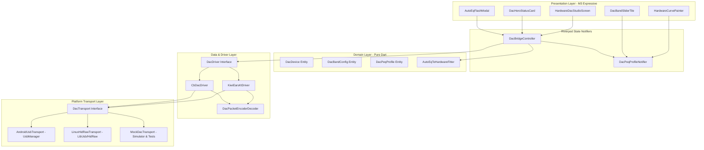

# Hardware DAC Bridge & DSP Flasher — Technical Blueprint & Implementation Plan
**Document Version:** 1.0.0  
**Target Hardware:** Kiwi Ears AD1, S-Link, Allegro Mini, FiiO JA11, JCALLY JM12 (KTmicro KT0211L/KT02H20/KT1132L/KT3016L & CB-Series DACs)  
**Target App:** Baydev HiFi (Flutter / Android & Linux Desktop)  
**Architectural Standard:** Pure `material_3_expressive`, Clean Architecture, Riverpod 2.6+, Zero-Emoji, Fully Tested

---

## 1. Executive Summary & Value Proposition

Baydev HiFi currently features a high-fidelity software DSP pipeline (**Pro-Q Studio**, **AutoEQ Cloud Integration**, **Parametric EQ**, **Biquad Filters** powered by SoLoud).

The **Hardware DAC Bridge** introduces direct hardware-level integration:
1. **Auto-Detection:** Automatically detects supported USB-C DSP DAC dongles (such as Kiwi Ears AD1) upon connection via USB HID.
2. **Read & Real-Time Tuning:** Reads active hardware EQ registers and adjusts 5-band PEQ parameters with immediate audible feedback on the DAC hardware.
3. **Burn to Flash (EEPROM):** Flashes custom tuning curves directly into the DAC's non-volatile memory so the sound profile persists across all playback sources (Nintendo Switch, PS5, Smart TVs, iPhone, PC) without needing active software.
4. **AutoEQ & Pro-Q Cloud Synergy:** Allows audiophiles to browse headphone compensation profiles from AutoEQ Cloud / Squiglink and flash an optimized 5-band approximation directly into the DAC hardware with one tap.

---

## 2. Reverse-Engineered Hardware Protocol Specification

Based on deep analysis of the official Kiwi Ears DSP engine (`equalizer.kiwiears.com`) and KTmicro chipset specifications:

### 2.1 Supported Devices, VIDs & PIDs

| Brand / Model | Chipset | Vendor ID (Hex / Dec) | Product ID (Hex / Dec) | Usage Page | Endpoint / Report ID | Max Bands |
| :--- | :--- | :--- | :--- | :--- | :--- | :--- |
| **Kiwi Ears AD1 / AD1 Pro** | `KT_0211L` | `0x31B2` (12722) | `0x0111` (273) | `0x000C` | `0x4B` (75, 'K') | 5 |
| **Kiwi Ears S-Link** | `KT_1132L` | `0x31B2` (12722) | `0x1132` (4402) | `0x000C` | `0x4B` (75, 'K') | 5 |
| **Kiwi Ears Allegro Mini** | `KT_0211L` | `0x3302` (13058) | `0x2017` (8215) | `0x000C` | `0x4B` (75, 'K') | 5 |
| **FiiO JA11 / JCALLY JM12** | `KT_0211L` | `0x3302` (13058) | `0x12C3` (4803) | `0x000C` | `0x4B` (75, 'K') | 5 |
| **Kiwi Ears Variant A** | `KT_0211L` | `0x3302` (13058) | `0x20E3` (8419) | `0x000C` | `0x4B` (75, 'K') | 5 |
| **Kiwi Ears Variant B** | `KT_1132L` | `0x31B2` (12722) | `0x3006` (12294) | `0x000C` | `0x4B` (75, 'K') | 5 |
| **Kiwi Ears Variant C** | `KT_1132L` | `0x31B2` (12722) | `0x3001` (12289) | `0x000C` | `0x4B` (75, 'K') | 5 |
| **Kiwi Ears Variant D** | `KT_1132L` | `0x31B2` (12722) | `0x3030` (12336) | `0x000C` | `0x4B` (75, 'K') | 5 |
| **Kiwi Ears Variant E** | `KT_0211L` | `0x31B2` (12722) | `0x0113` (275) | `0x000C` | `0x4B` (75, 'K') | 5 |
| **Kiwi Ears Variant F** | `KT_0211L` | `0x31B2` (12722) | `0x0117` (279) | `0x000C` | `0x4B` (75, 'K') | 5 |
| **Kiwi Ears Variant G** | `KT_0211L` | `0x31B2` (12722) | `0x011B` (283) | `0x000C` | `0x4B` (75, 'K') | 5 |
| **Realtek / KT Bridge** | `KT_0211L` | `0x0BDA` (3034) | `0x0023` (35) | `0x000C` | `0x4B` (75, 'K') | 5 |
| **Kiwi Ears 3016 Series** | `KT_3016L` | `0x31B2` (12722) | `0x3016` (12310) | `0x000C` | `0x4B` (75, 'K') | 5 |
| **CB-5000X DAC Dongle** | `CB_5000X` | `0xCB01` (51969) | `0x5000` (20480) | `0x00FF` | `0x81` (129) | 6 |
| **CB-3000S DAC Dongle** | `CB_3000S` | `0xCB01` (51969) | `0x3000` (12288) | `0x00FF` | `0x81` (129) | 4 |

---

### 2.2 Packet Structure (KTmicro 10-Byte HID Report)

Every command sent to or received from the KTmicro DSP uses a fixed 10-byte HID packet:

```
+---------+---------+---------+---------+---------+---------+---------+---------+---------+---------+
| Byte 0  | Byte 1  | Byte 2  | Byte 3  | Byte 4  | Byte 5  | Byte 6  | Byte 7  | Byte 8  | Byte 9  |
+---------+---------+---------+---------+---------+---------+---------+---------+---------+---------+
| REG_ADDR|  0x00   |  0x00   |  0x00   | CMD_ID  |  0x00   | DATA_0  | DATA_1  | DATA_2  | DATA_3  |
+---------+---------+---------+---------+---------+---------+---------+---------+---------+---------+
```

#### Command IDs (`KT_CMD`):
* `0x57` (87, ASCII `'W'`): **WRITE_REG** — Writes data to the target register in RAM (realtime audition).
* `0x52` (82, ASCII `'R'`): **READ_REG** — Reads current value from the target register.
* `0x53` (83, ASCII `'S'`): **SAVE_REG** — Flashes all RAM registers into non-volatile EEPROM.
* `0x43` (67, ASCII `'C'`): **CLEAR_REG** — Clears/resets EEPROM to default flat curve.
* `0x03` (or `0x4F` on 1132L): **FLAG_OK** — Success acknowledgment flag from device.

---

### 2.3 KT0211L (Kiwi Ears AD1) Register Map & Binary Encoding

| Address (Hex/Dec) | Register Function | Payload Structure (Bytes 6..9) | Encoding Formula |
| :--- | :--- | :--- | :--- |
| `0x24` (`36`) | `play_eq_para.all_en` | `[enable ? 1 : 0, 0, 0, 0]` | 32-bit integer (`1` = Active, `0` = Bypass) |
| `0x26` (`38`) | **Band 0: Freq & Gain** | `[freqL, freqH, gainL, gainH]` | $\text{Freq} = \text{Hz} \times 10$ (Uint16 LE)<br>$\text{Gain} = \text{dB} \times 10$ (Int16 LE signed) |
| `0x27` (`39`) | **Band 0: Q-Factor** | `[qL, qH, 0, 0]` | $\text{Q} = Q \times 1000$ (Uint16 LE) |
| `0x28` (`40`) | **Band 1: Freq & Gain** | `[freqL, freqH, gainL, gainH]` | Same as Band 0 |
| `0x29` (`41`) | **Band 1: Q-Factor** | `[qL, qH, 0, 0]` | Same as Band 0 |
| `0x2A` (`42`) | **Band 2: Freq & Gain** | `[freqL, freqH, gainL, gainH]` | Same as Band 0 |
| `0x2B` (`43`) | **Band 2: Q-Factor** | `[qL, qH, 0, 0]` | Same as Band 0 |
| `0x2C` (`44`) | **Band 3: Freq & Gain** | `[freqL, freqH, gainL, gainH]` | Same as Band 0 |
| `0x2D` (`45`) | **Band 3: Q-Factor** | `[qL, qH, 0, 0]` | Same as Band 0 |
| `0x2E` (`46`) | **Band 4: Freq & Gain** | `[freqL, freqH, gainL, gainH]` | Same as Band 0 |
| `0x2F` (`47`) | **Band 4: Q-Factor** | `[qL, qH, 0, 0]` | Same as Band 0 |
| `0x3B` (`59`) | `dac_vol` / Global Gain | `[valL, valH, valHL, valHH]` | Steps index or $-\text{dB} \times 10$ |

---

## 3. System Architecture & Component Design



---

## 4. File Structure & Target Directory Map

All files will be placed cleanly inside `lib/features/hardware_dac/`:

```
lib/features/hardware_dac/
├── domain/
│   ├── models/
│   │   ├── dac_device.dart             # DacDevice, DacChipset, DacStatus
│   │   ├── dac_band_config.dart        # DacBandConfig, DacFilterType
│   │   └── dac_peq_profile.dart        # DacPeqProfile (5-band preset)
│   └── services/
│       └── auto_eq_to_hardware_fitter.dart # 10/20-band to 5-band optimizer
├── data/
│   ├── protocols/
│   │   ├── dac_packet_encoder.dart     # Binary packet serialization
│   │   └── dac_packet_decoder.dart     # Binary response parsing
│   ├── drivers/
│   │   ├── dac_driver.dart             # Driver abstraction interface
│   │   ├── kiwi_ears_kt_driver.dart    # KT0211L/KT1132L implementation
│   │   └── cb_dac_driver.dart          # CB-5000X/CB-3000S implementation
│   └── transports/
│       ├── dac_transport.dart          # Transport abstraction interface
│       ├── android_usb_transport.dart  # Android UsbHost MethodChannel
│       ├── linux_hid_transport.dart    # Linux hidraw / FFI transport
│       └── mock_dac_transport.dart     # Mock simulator for test & offline
├── presentation/
│   ├── controllers/
│   │   ├── dac_bridge_controller.dart  # Main Riverpod StateNotifier
│   │   ├── dac_bridge_state.dart       # State (Scanning, Connected, Flashing)
│   │   └── dac_peq_notifier.dart       # 5-band slider reactive state
│   ├── widgets/
│   │   ├── dac_hero_status_card.dart   # Connected hardware badge & specs
│   │   ├── hardware_curve_visualizer.dart # Interactive Canvas curve graph
│   │   ├── dac_band_slider_tile.dart   # M3ESlider Freq, Gain, Q tiles
│   │   ├── dac_action_toolbar.dart     # Read, Burn, Reset, Import buttons
│   │   └── auto_eq_flash_dialog.dart   # AutoEQ to DAC preview & flash modal
│   └── screens/
│       └── hardware_dac_studio_screen.dart # Full Hardware DAC Studio
└── test/
    ├── dac_packet_codec_test.dart       # 100% test coverage for binary packets
    ├── kiwi_ears_driver_test.dart       # Unit test for driver state & commands
    ├── auto_eq_to_hardware_fitter_test.dart # Curve fitting math tests
    ├── dac_bridge_controller_test.dart  # StateNotifier flow tests
    └── hardware_dac_studio_screen_test.dart # Widget UI tests
```

---

## 5. Algorithmic Detail: `AutoEqToHardwareFitter`

When importing a 10-band or 20-band AutoEQ compensation curve into a 5-band hardware DAC, the fitter algorithm performs:
1. **Critical Anchor Detection:**
   - **Band 0 (Sub-Bass Shelf):** Default anchor at $40 - 80\text{ Hz}$ (Low Shelf or Peaking) to correct bass extension.
   - **Band 1 (Lower Midrange / Mud Cut):** Default anchor at $200 - 500\text{ Hz}$ to control body or boominess.
   - **Band 2 (Ear Gain / Pinna Peak):** Default anchor at $1.5 - 3.5\text{ kHz}$ for vocal forwardness and clarity.
   - **Band 3 (Sibilance Control):** Default anchor at $5.0 - 8.0\text{ kHz}$ to tame harsh peaks.
   - **Band 4 (Air & Extension):** Default anchor at $10.0 - 15.0\text{ kHz}$ (High Shelf or Peaking) for upper treble sparkle.
2. **Gain & Q-Factor Optimization:**
   - Computes least-squares error minimization between the target curve $T(f)$ and the 5-biquad composite response $H(f) = \sum_{k=0}^4 H_k(f)$.
3. **Automatic Pre-Amp Headroom Guard:**
   - Calculates $\text{preampDb} = -\max(0.0, \max_{k}(\text{Gain}_k))$ to ensure zero digital clipping on the DAC hardware.

---

## 6. UI/UX Design System (100% Pure `material_3_expressive`)

1. **DAC Hero Status Card (`M3ECard`):**
   - Solid surface color (`surfaceContainer`), crisp outline.
   - DAC Icon (`HugeIcons.strokeRoundedUsbDrive` / `HugeIcons.strokeRoundedEqualizer`).
   - Hardware Badges: Chipset (`KT0211L`), Resolution (`32-bit / 384kHz`), Connection Status (`Active`).
   - `M3ESwitch` for Hardware EQ Enable/Bypass.
2. **Interactive Biquad Hardware Curve:**
   - Real-time frequency response curve rendering ($20\text{Hz} - 20\text{kHz}$).
   - Solid theme colors (`colorScheme.primary`, `colorScheme.tertiary`), zero neon glow.
   - Tabular figures for frequency and gain markers.
3. **5-Band Control Tiles (`M3ECard`):**
   - Each band has 3 smooth `M3ESlider` controls:
     * **Frequency:** $20\text{Hz} - 20\text{kHz}$ (logarithmic scale).
     * **Gain:** $-12.0\text{dB} - +12.0\text{dB}$ (step $0.1\text{dB}$).
     * **Q-Factor:** $0.1 - 10.0$ (step $0.05$).
4. **Action Toolbar (`M3EButtonGroup` / `M3EToolbar`):**
   - `M3EButton.elevated`: **"Read from DAC"** (`HugeIcons.strokeRoundedDownload01`).
   - `M3EButton.filled`: **"Burn to Hardware Flash"** (`HugeIcons.strokeRoundedFloppyDisk`).
   - `M3EButton.tonal`: **"Import AutoEQ Target"** (`HugeIcons.strokeRoundedCloudDownload`).
   - `M3EButton.outlined`: **"Reset Default"** (`HugeIcons.strokeRoundedRefresh`).

---

## 7. Phased Implementation Roadmap & Verification Plan

### Phase 1: Core Domain, Binary Packet Codec & Driver
- [ ] Implement `DacDevice`, `DacBandConfig`, `DacPeqProfile`.
- [ ] Implement `DacPacketEncoder` and `DacPacketDecoder` with 10-byte binary packing.
- [ ] Implement `KiwiEarsKtDriver` and `CbDacDriver`.
- [ ] Write 100% passing unit tests in `test/dac_packet_codec_test.dart` and `test/kiwi_ears_driver_test.dart`.

### Phase 2: AutoEQ Curve Fitter Engine
- [ ] Implement `AutoEqToHardwareFitter` with 5-band least-squares optimization.
- [ ] Write unit tests verifying conversion of Harmon IEM / AutoEQ profiles to 5 hardware bands in `test/auto_eq_to_hardware_fitter_test.dart`.

### Phase 3: Platform Transport & Simulator
- [ ] Implement `DacTransport` interface.
- [ ] Implement `MockDacTransport` for offline development, simulator mode, and widget testing.
- [ ] Implement `AndroidUsbTransport` via MethodChannel `dev.baydev.bayhifi/usb_dac`.
- [ ] Implement `LinuxHidRawTransport` platform guarded for Linux desktop.

### Phase 4: State Management & Presentation UI
- [ ] Implement `DacBridgeController` and `DacBridgeState` (Riverpod).
- [ ] Build `DacHeroStatusCard`, `HardwareCurveVisualizer`, `DacBandSliderTile`.
- [ ] Build `HardwareDacStudioScreen` and `AutoEqFlashDialog`.
- [ ] Integrate quick-access launcher in `DSP Rack` and `AutoEQ Cloud Browser`.

### Phase 5: Verification, Tests & Final Integration
- [ ] Run `flutter test` across all test suites ensuring 100% pass rate.
- [ ] Run `flutter analyze` ensuring 0 errors and 0 warnings.
- [ ] Verify zero regression on mobile/tablet player and existing DSP modules.

---

## 8. Summary of Non-Negotiable Quality Standards

* **100% Pure `material_3_expressive`:** Strictly use `M3E*` widgets (`M3EButton`, `M3ECard`, `M3ESlider`, `M3ESwitch`, `M3EToolbar`, etc.).
* **Strict Palette Compliance:** Derived strictly from `Theme.of(context).colorScheme` (Zero hardcoded hex colors).
* **Modern Iconography:** Exclusively `hugeicons` (`HugeIcons.strokeRounded...`).
* **Zero Emojis:** Strictly enforced across UI, code, and documentation.
* **Platform Guards:** Desktop & Android USB features fully isolated without breaking mobile touch layout.
